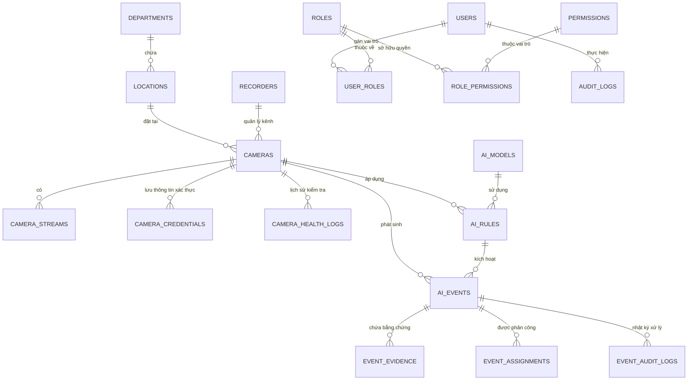

# THIẾT KẾ CƠ SỞ DỮ LIỆU (ERD) — AI HOSPITAL CAMERA V1.0

## 1. Sơ đồ Quan hệ Thực thể (ERD)

## 2. Bảng Danh mục Thực thể Chính

| Tên Bảng | Khóa Chính | Mục Đích Lưu Trữ | Lưu Ý Bảo Mật / Chỉ Mục |
| :--- | :--- | :--- | :--- |
| `users` | UUID | Danh sách nhân viên, tài khoản đăng nhập | `email` index, mật khẩu mã hóa bcrypt |
| `roles` & `permissions` | UUID | Kiểm soát phân quyền dựa trên vai trò (RBAC) | Quyền chi tiết theo tài nguyên:action |
| `departments` & `locations` | UUID | Phân cấp vị trí thực tế trong bệnh viện | Khoa phòng, tòa nhà, tầng, số phòng |
| `recorders` | UUID | Đầu ghi hình NVR / VMS | Quản lý địa chỉ IP, hãng, model |
| `cameras` | UUID | Danh mục thiết bị camera IP | Chỉ mục `status`, cờ `is_demo`, cờ `deleted_at` |
| `camera_streams` | UUID | Luồng stream main / sub | `rtsp_url_encrypted` mã hóa server-side |
| `camera_credentials` | UUID | Mật khẩu & tài khoản camera | Mã hóa an toàn, không bao giờ gửi ra client |
| `camera_health_logs` | UUID | Lịch sử đo độ trễ và mất kết nối | Chỉ mục kép `(camera_id, checked_at)` |
| `ai_models` | UUID | Danh mục model YOLO / Pose / Action | Ghi nhận backend (cpu / cuda / tensorrt) |
| `ai_rules` | UUID | Cấu hình quy tắc AI từng camera | JSONB đa giác ROI, lịch trình, cooldown |
| `ai_events` | UUID | Sự cố và cảnh báo phát sinh từ AI | Chỉ mục `(occurred_at, status)`, `is_simulated` |
| `event_evidence` | UUID | Metadata bằng chứng (ảnh snapshot / clip) | Khóa lưu trữ relative, checksum SHA-256 |
| `audit_logs` | UUID | Nhật ký bảo mật toàn hệ thống | Ghi nhận IP, hành động, tài nguyên |
